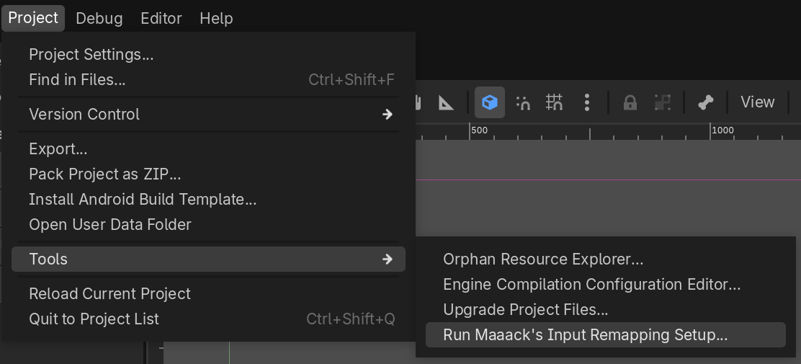
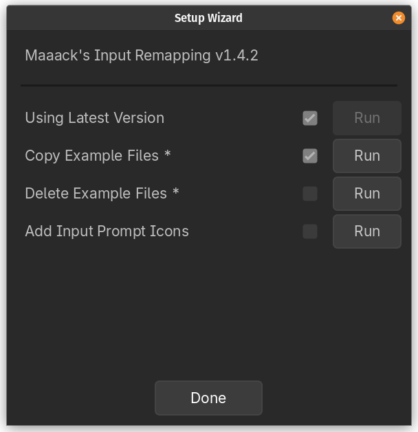

# Basic Setup

These instructions cover the basics for setting up the template.

## Setup Wizard

The _Setup Wizard_ shows the user's progress through the setup process.

### Open

Open the _Setup Wizard_ by navigating to `Project > Tools > Run Maaack's Input Remapping Setup...`.

### Check & Complete

A typical full installation will have the following steps completed:  
-  Using Latest Version
-  Copy Example Files
-  Delete Example Files

Depending on how the template was installed, or if any issues occurred, some of these may need to be run from the wizard to be completed.

The remaining steps are optional customizations.

## Next Steps

### Recommended
1.  [Input Remapping Menus](/docs/InputRemappingMenus.md)  
2.  [Adding Icons to the Input Options](/docs/InputIconMapping.md)  
3.  [Supporting Joypad Inputs](/docs/JoypadInputs.md)  
