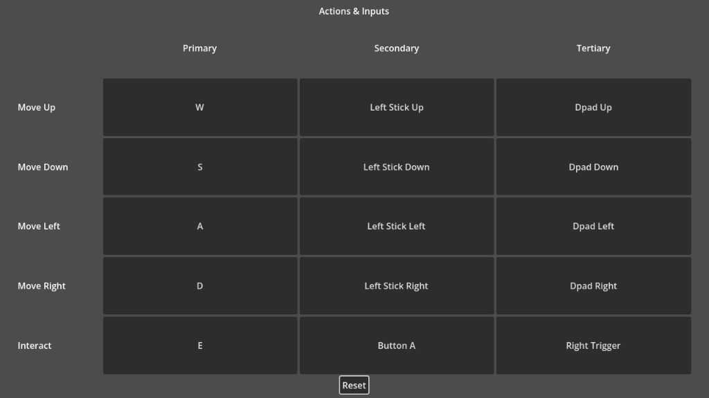
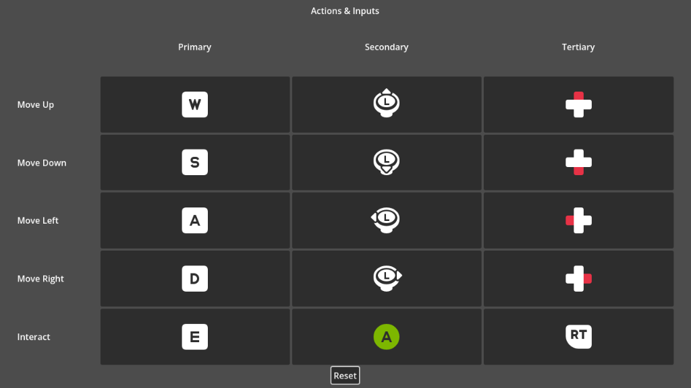
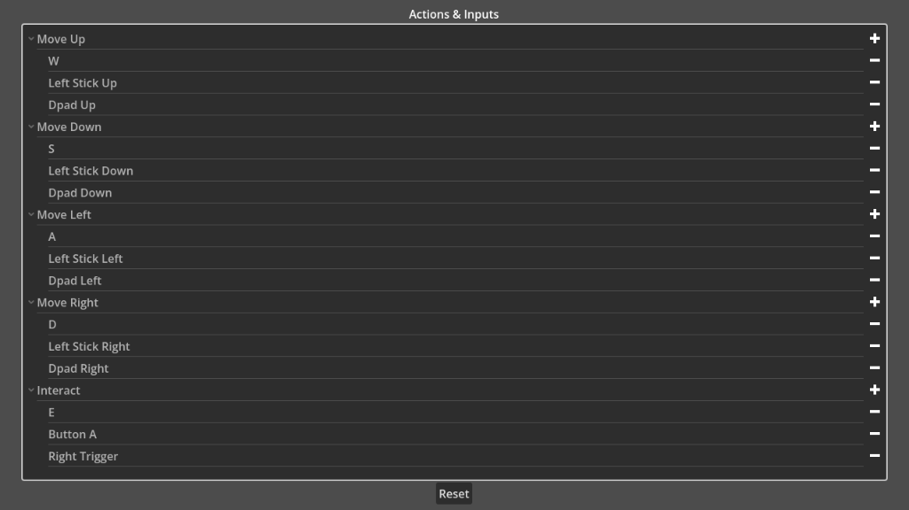
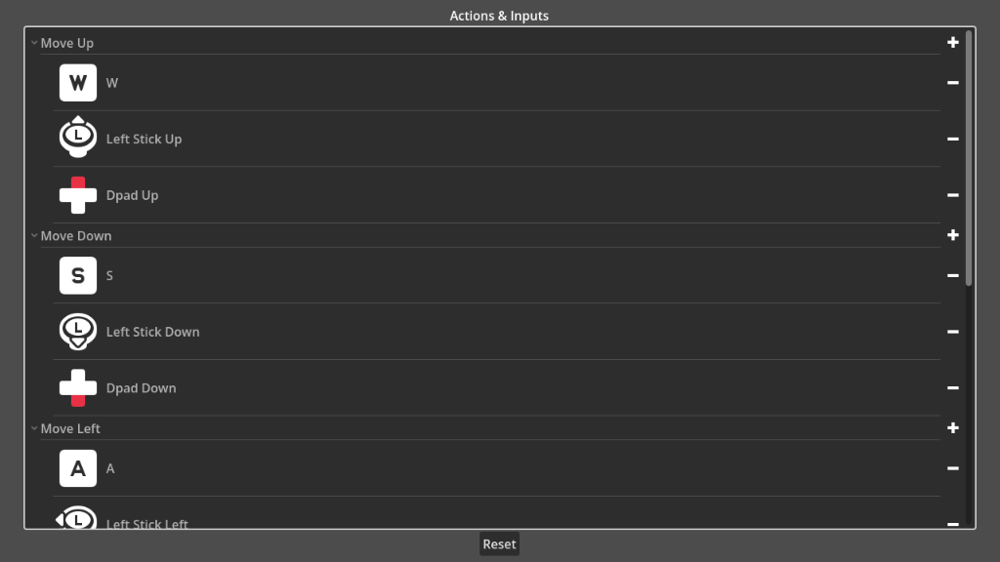
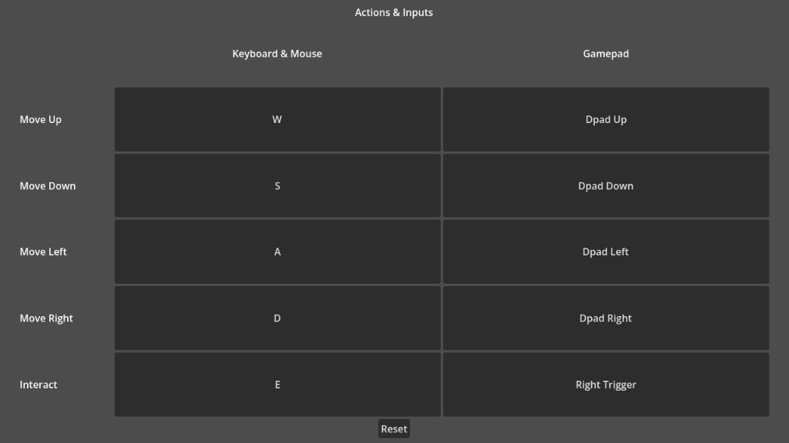
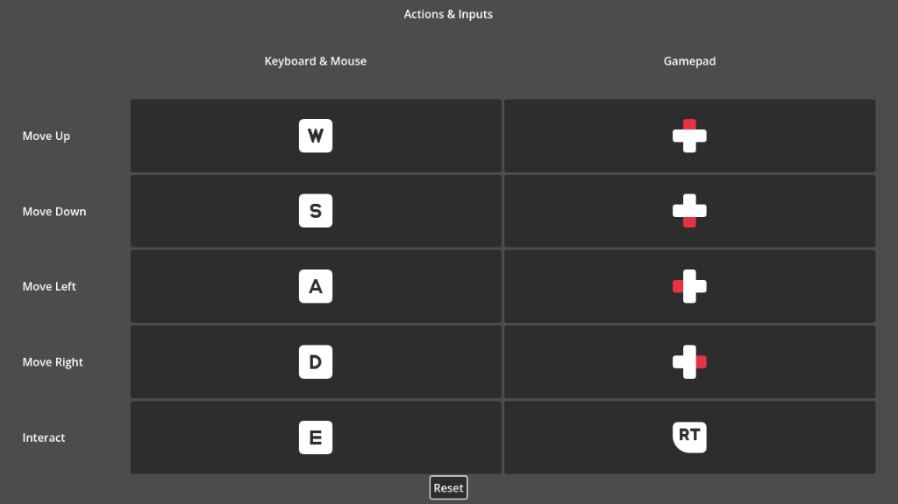

# Input Remapping Menus

The `input_options_menu.tscn` is a menu controller that can switch between different remapping menus provided with the addon/template.

The current options are:

* List (Default)
* Tree
* Device Groups

To change to a different input remapping menu, open `input_options_menu.tscn`, select the **Control** node in the *SceneTree*, and then change the **Remapping Mode** in the *Inspector*.

## List

The **List** remapping menu allows the player to remap an adjustable number of inputs per action, regardless of the input device. To adjust the number of editable inputs per action, select the **InputActionsList** in the *SceneTree*, and then adjust the **Action Groups** in the *Inspector*.

## Tree

The **Tree** remapping menu allows the player to remap any number of inputs per action, regardless of the input device.

## Device Group

The **Device Group** remapping menu is similar to the **List**, but it allows the player to remap inputs by specific input devices. To adjust the type of devices that can be edited, select the **InputActionsDeviceGroups** in the *SceneTree*, and then change the **Action Group Input Devices** in the *Inspector*.

## Next Steps

### Recommended
1.  [Adding Icons to the Input Options](/docs/InputIconMapping.md)  
2.  [Supporting Joypad Inputs](/docs/JoypadInputs.md)  
